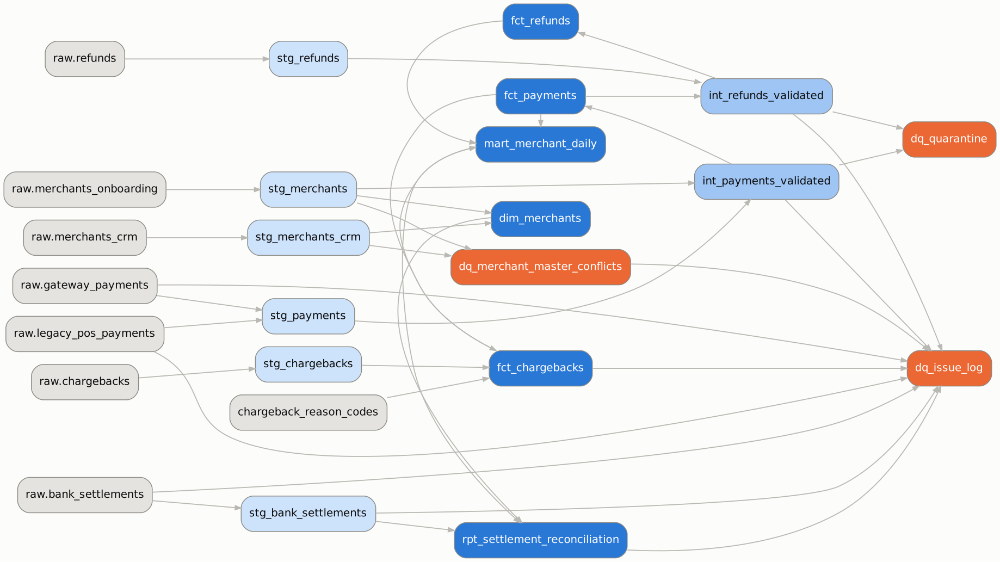
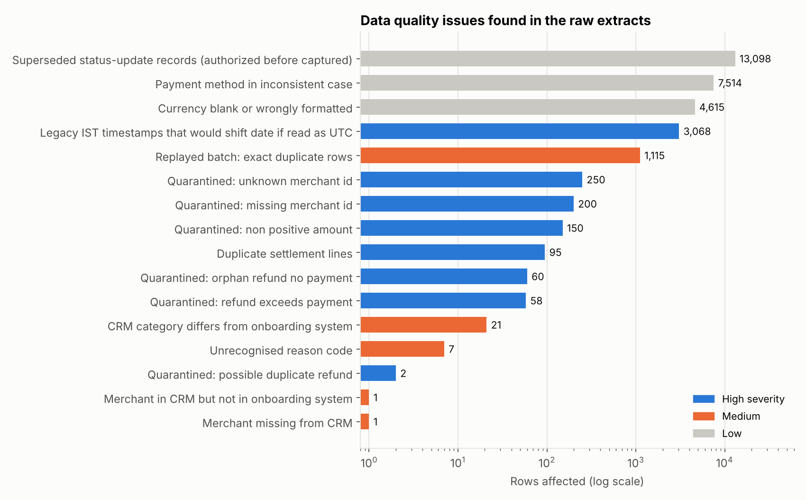
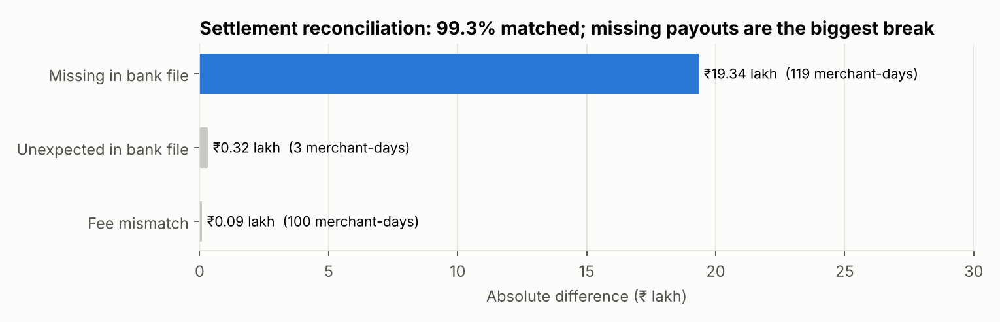

# Payments Data Pipeline with dbt: Quality, Lineage and Settlement Reconciliation

A dbt pipeline that takes messy extracts from a payments business's source systems, cleans
and tests them, keeps an audit trail of every record it rejects, and reconciles what the
bank paid out against what it should have paid.

**Scale:** 7 source extracts · 167,483 raw payment rows · 400 merchants · Jan–Mar 2026 ·
17 dbt models · 37 data tests · CI on GitHub Actions and GitLab.

> **Data note.** All data is synthetic (`src/generate_raw.py`, fixed seed). The generator first
> builds the true record of what happened, then writes the raw files the way real source
> systems deliver them: mixed formats, replayed batches, junk rows and bank-side errors.
> `outputs/verification.json` confirms that the pipeline recovers the truth exactly.

## Headline findings

1. **₹19.3 lakh of settlements were never paid.** 119 merchant-days are missing from the
   bank's settlement file. Overall, 99.3% of 31,804 merchant-days reconcile to the rupee.
2. **The bank overcharged four merchants from 2 March.** It applied a fee rate 0.25
   percentage points above the contracted merchant discount rate (MDR) for 100
   merchant-days. The pipeline infers the rate the bank applied from its own fee figures.
3. **A time-zone trap worth ₹1 crore.** The legacy in-store feed sends local IST times in a
   different format. Read as UTC like the gateway feed, 3,068 payments (₹1.0 crore) would
   land on the wrong business date and break the reconciliation.
4. **720 records quarantined, not dropped.** These are payments with missing or unknown
   merchants, zero or negative amounts, refunds larger than the payment, and refunds for
   payments that don't exist. Each one sits in `audit.dq_quarantine` with its reason.
5. **Two systems disagree about merchants.** The CRM gives a different category for 21
   merchants. The onboarding system is the authoritative source, and conflicts are logged
   for the data owner.
6. **Duplicates at both ends.** 1,115 replayed gateway rows and 95 duplicate bank
   settlement lines were collapsed. The duplicates in the bank file should be confirmed with
   the bank, to rule out double payment.





Full write-up: **[`report/data_quality_report.md`](report/data_quality_report.md)**

## How the pipeline is built

```
data/raw/*.csv ──load_raw.py──▶ raw (all text, as delivered)
                                  │
                       dbt  ──────┼──▶ staging       cast, standardise, convert to IST, deduplicate
                                  ├──▶ intermediate  validate every record against business rules
                                  ├──▶ marts         fct_payments, fct_refunds, fct_chargebacks, dim_merchants,
                                  │                  mart_merchant_daily, rpt_settlement_reconciliation
                                  └──▶ audit         dq_quarantine, dq_issue_log, dq_merchant_master_conflicts
```

**Design choices**
- **Land raw data as text.** A bad value becomes a data quality finding in staging, not a
  failed load.
- **Quarantine, don't drop.** Invalid rows are labelled in the intermediate layer and routed
  to `audit.dq_quarantine`. A completeness test proves every payment is accounted for.
- **Name the authoritative source.** Merchant pricing and category come from the onboarding
  system. The CRM is only used to detect conflicts.
- **Keep chargebacks with bad codes.** They are real money, so they stay in the fact table,
  flagged, instead of being quarantined.
- **Reconcile to an independent source.** Expected settlement = captured − refunds − fees
  (MDR + 18% GST), paid the next day (T+1), compared line by line with the bank file.

**Tests (`dbt build` runs all of them)**
- **Generic tests:** `unique`, `not_null`, `accepted_values`, `relationships`, plus two custom
  ones: `positive` and `unique_combination`.
- **Singular controls:**
  - every payment is either in the fact table or in quarantine;
  - refunds never exceed the payment;
  - captured totals match between layers;
  - at least 99% of settlements reconcile (a warning, not a failure).
- **Warn-level tests** surface upstream issues (unknown merchants, unrecognised chargeback
  codes) without stopping the pipeline.

## Run it

```bash
pip install -r requirements.txt
python run_all.py          # generate → load → dbt build (models + tests) → dbt docs → report
cd dbt && dbt docs serve --profiles-dir .   # browse the model docs and lineage graph
```

The warehouse is a local DuckDB file, so it runs anywhere with no setup. To run on Snowflake
or Databricks, point `dbt/profiles.yml` at that warehouse. The models use standard SQL plus
a few DuckDB functions (`try_strptime`, `try_cast`), each of which has a direct equivalent
there.

## Repo layout

```
src/generate_raw.py      synthetic source extracts with injected data quality problems
src/load_raw.py          lands raw files in the warehouse
dbt/                     dbt project: models, tests, macros, seed (chargeback reason codes)
src/report.py            DQ extracts, charts, lineage diagram from dbt's manifest, truth check
.github/workflows/ci.yml GitHub Actions: build and test on every push
.gitlab-ci.yml           the same pipeline for GitLab CI
outputs/                 issue log, reconciliation breaks, fee mismatches, verification
report/                  data quality report
```
